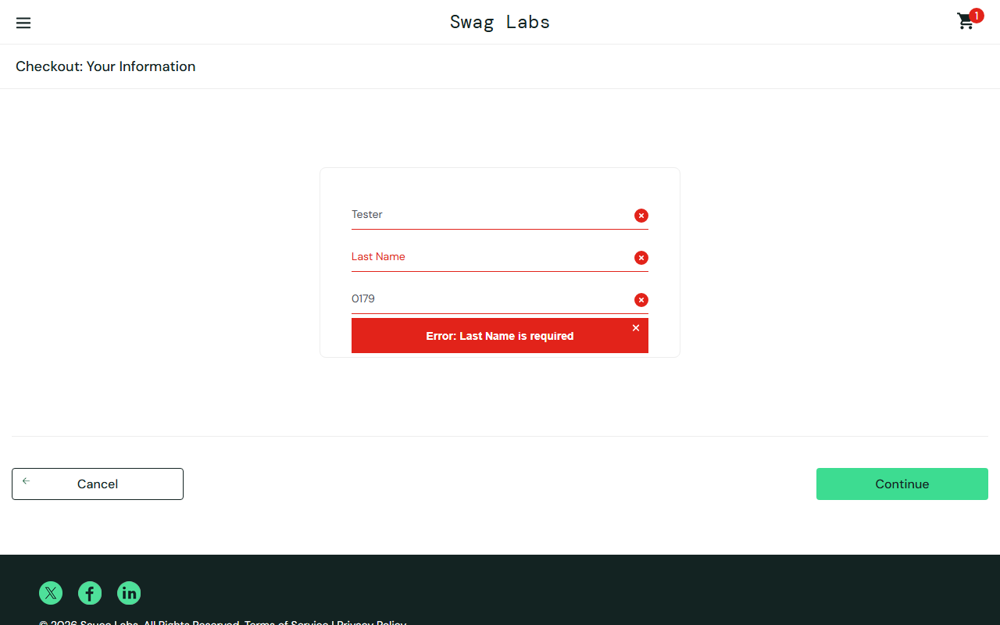
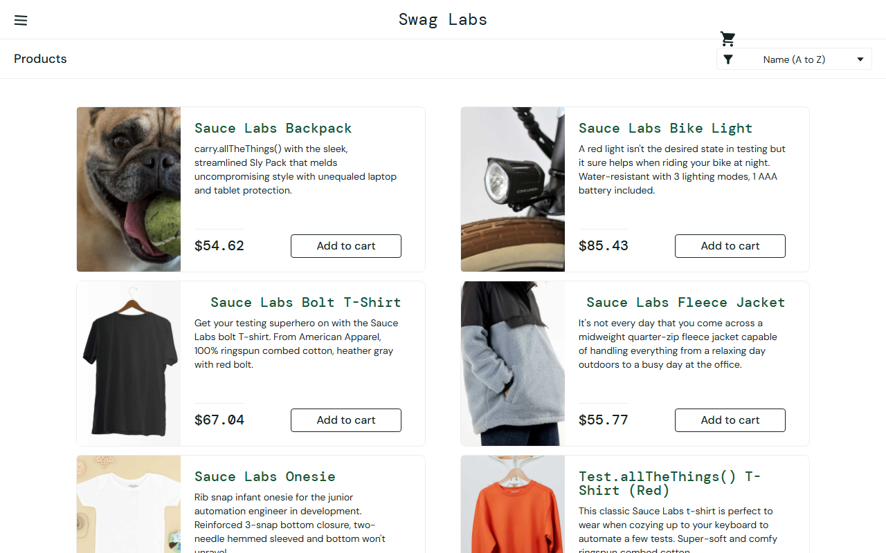

# Bug Reports: Swag Labs Web Shop

| | |
|---|---|
| **Document ID** | BR-SL-001 |
| **Reporter** | Davit Jikurashvili |
| **Date found** | 17 October 2026 |
| **Environment** | https://www.saucedemo.com · Chromium (Playwright) and Chrome, Windows 11, 1280×800 |
| **Password for all accounts** | `secret_sauce` |

Each defect below was reproduced at least twice. Results are compared with the baseline account `standard_user`, where the same steps work correctly.

## Summary

| ID | Title | Account | Severity | Priority |
|---|---|---|---|---|
| BUG-001 | All products show the same placeholder image | problem_user | Medium | P2 |
| BUG-002 | Product sorting has no effect | problem_user | Medium | P2 |
| BUG-003 | "Add to cart" does nothing for 3 of 6 products | problem_user | High | P1 |
| BUG-004 | "Remove" on the products page does not remove items | problem_user | High | P2 |
| BUG-005 | Typing in Last Name overwrites First Name; checkout blocked | problem_user | Critical | P1 |
| BUG-006 | Product link opens the wrong product | problem_user | High | P2 |
| BUG-007 | "Add to cart" throws a JavaScript error for 3 products | error_user | High | P1 |
| BUG-008 | Checkout continues with an empty, uneditable Last Name | error_user | High | P2 |
| BUG-009 | "Finish" does not complete the order | error_user | Critical | P1 |
| BUG-010 | Product list shows wrong prices that change on reload | visual_user | Critical | P1 |
| BUG-011 | Login takes about 5 seconds | performance_glitch_user | Medium | P2 |
| BUG-012 | Layout defects: wrong image, misplaced cart icon, shifted titles | visual_user | Low | P3 |

**Totals:** 3 Critical · 5 High · 3 Medium · 1 Low

---

## BUG-001: All products show the same placeholder image

| Field | Value |
|---|---|
| **Severity / Priority** | Medium / P2 |
| **Account** | problem_user |
| **Related test case** | TC-011 |

**Steps to reproduce**
1. Log in as `problem_user`.
2. Look at the product images on the Products page.

**Expected:** Each of the 6 products shows its own product photo.

**Actual:** All 6 products show the same image (a dog). Every `` points to `/assets/sl-404-*.jpg`.

**Impact:** Customers cannot see what they are buying, which is likely to reduce conversion.

---

## BUG-002: Product sorting has no effect

| Field | Value |
|---|---|
| **Severity / Priority** | Medium / P2 |
| **Account** | problem_user (also reproduced with error_user) |
| **Related test cases** | TC-013, TC-014 |

**Steps to reproduce**
1. Log in as `problem_user`.
2. Select **Name (Z to A)** in the sort dropdown.
3. Select **Price (low to high)**.

**Expected:** The list is re-ordered: Z→A starts with "Test.allTheThings() T-Shirt (Red)"; low→high starts with $7.99.

**Actual:** The order stays A→Z (Backpack $29.99 first) after both selections.

---

## BUG-003: "Add to cart" does nothing for 3 of 6 products

| Field | Value |
|---|---|
| **Severity / Priority** | High / P1 |
| **Account** | problem_user |
| **Related test case** | TC-019 |

**Steps to reproduce**
1. Log in as `problem_user` with an empty cart.
2. Click **Add to cart** on each of the 6 products.

**Expected:** All 6 buttons change to **Remove**; the cart badge shows 6.

**Actual:** Only Backpack, Bike Light and Onesie are added. **Bolt T-Shirt**, **Fleece Jacket** and **Test.allTheThings() T-Shirt (Red)** stay on "Add to cart"; the badge shows 3.

**Impact:** Half the catalogue cannot be bought.

---

## BUG-004: "Remove" on the products page does not remove items

| Field | Value |
|---|---|
| **Severity / Priority** | High / P2 |
| **Account** | problem_user |
| **Related test case** | TC-020 |

**Steps to reproduce**
1. Log in as `problem_user`.
2. Add Backpack, Bike Light and Onesie to the cart (badge = 3).
3. Click **Remove** on each of them on the Products page.

**Expected:** Buttons return to **Add to cart**; the badge disappears.

**Actual:** The buttons stay on **Remove** and the badge still shows 3.

**Workaround:** Remove the items from the Cart page.

---

## BUG-005: Typing in Last Name overwrites First Name; checkout blocked

| Field | Value |
|---|---|
| **Severity / Priority** | Critical / P1 |
| **Account** | problem_user |
| **Related test case** | TC-029 |

**Steps to reproduce**
1. Log in as `problem_user` and add any product to the cart.
2. Open the cart → **Checkout**.
3. Type `Davit` in **First Name**, `Tester` in **Last Name**, `0179` in **Postal Code**.
4. Click **Continue**.

**Expected:** The fields contain Davit / Tester / 0179 and the order overview opens.

**Actual:** Text typed into Last Name replaces the First Name value (First Name = "Tester"), Last Name stays empty, and the error "Last Name is required" is shown.

**Impact:** The user cannot complete any purchase; there is no workaround.

---

## BUG-006: Product link opens the wrong product

| Field | Value |
|---|---|
| **Severity / Priority** | High / P2 |
| **Account** | problem_user |
| **Related test case** | TC-016 |

**Steps to reproduce**
1. Log in as `problem_user`.
2. Click the product name **Sauce Labs Backpack**.

**Expected:** The Sauce Labs Backpack detail page opens (`inventory-item.html?id=4`).

**Actual:** The **Sauce Labs Fleece Jacket** page opens (`?id=5`).

**Impact:** Customers may buy the wrong item.

---

## BUG-007: "Add to cart" throws a JavaScript error for 3 products

| Field | Value |
|---|---|
| **Severity / Priority** | High / P1 |
| **Account** | error_user |
| **Related test cases** | TC-019, TC-035 |

**Steps to reproduce**
1. Open DevTools → Console.
2. Log in as `error_user`.
3. Click **Add to cart** on Bolt T-Shirt, Fleece Jacket and Test.allTheThings() T-Shirt (Red).

**Expected:** Products are added; no console errors.

**Actual:** The products are not added, and the console shows an uncaught error `Failed to add item to the cart.` for each click. **Remove** also fails, with `Failed to remove item from cart.`

---

## BUG-008: Checkout continues with an empty, uneditable Last Name

| Field | Value |
|---|---|
| **Severity / Priority** | High / P2 |
| **Account** | error_user |
| **Related test cases** | TC-027, TC-029 |

**Steps to reproduce**
1. Log in as `error_user` and add Backpack to the cart.
2. Cart → **Checkout**.
3. Type `Davit`, `Tester`, `0179` into the three fields and click **Continue**.

**Expected:** Last Name accepts input. If it is empty, the error "Last Name is required" blocks the step.

**Actual:** Last Name stays empty whatever is typed, and the form still moves to the order overview without a last name. **Validation is bypassed.**

**Impact:** Orders can be created with incomplete customer data.

---

## BUG-009: "Finish" does not complete the order

| Field | Value |
|---|---|
| **Severity / Priority** | Critical / P1 |
| **Account** | error_user |
| **Related test case** | TC-025 |

**Steps to reproduce**
1. Log in as `error_user` and add Backpack to the cart.
2. Complete checkout step 1 and continue to **Checkout: Overview**.
3. Click **Finish**.

**Expected:** The "Thank you for your order!" page opens.

**Actual:** Nothing visible happens; the user stays on the overview page. The console shows a JavaScript `TypeError: ... is not a function`.

**Impact:** No order can be placed.

---

## BUG-010: Product list shows wrong prices that change on reload

| Field | Value |
|---|---|
| **Severity / Priority** | Critical / P1 |
| **Account** | visual_user |
| **Related test cases** | TC-012, TC-014 |

**Steps to reproduce**
1. Log in as `visual_user`.
2. Note the prices on the Products page.
3. Select **Price (low to high)**, or reload the page.

**Expected:** Backpack $29.99, Bike Light $9.99, … (same as `standard_user`), always with 2 decimals; low→high shows ascending prices.

**Actual:** Prices are random and different on every render (e.g. Backpack $86.2, then $54.62; Bike Light $0.5). Some are missing the second decimal, and after "low to high" the list is not in ascending order. The checkout overview still charges the real price ($29.99), so **the price shown does not match the price charged**.

**Impact:** Misleading pricing; a possible legal and compliance issue.

---

## BUG-011: Login takes about 5 seconds

| Field | Value |
|---|---|
| **Severity / Priority** | Medium / P2 |
| **Account** | performance_glitch_user |
| **Related test case** | TC-033 |

**Steps to reproduce**
1. Log in as `performance_glitch_user`.
2. Measure the time from clicking **Login** until the Products page is shown.

**Expected:** Under 2 seconds.

**Actual:** About 5.1 seconds every time (3 warm runs: 5.11 s, 5.12 s, 5.14 s), compared with about 0.1 s for `standard_user` under the same conditions (0.14 s, 0.11 s, 0.10 s). That is about 45 times slower.

**Impact:** A poor first impression; users may abandon the session.

---

## BUG-012: Layout defects: wrong image, misplaced cart icon, shifted titles

| Field | Value |
|---|---|
| **Severity / Priority** | Low / P3 |
| **Account** | visual_user |
| **Related test case** | TC-034 |

**Steps to reproduce**
1. Log in as `visual_user` and compare the Products page with `standard_user`.

**Expected:** The layout is identical to the baseline.

**Actual:**
- The Sauce Labs Backpack shows a dog photo instead of the backpack
- The cart icon is shifted out of the header, above the sort dropdown
- The "Bolt T-Shirt" and "Fleece Jacket" titles are offset to the right

See the BUG-010 screenshot above.
